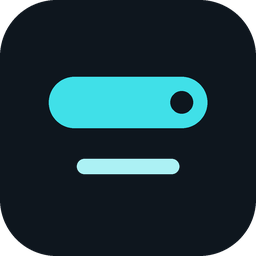

# CyaNotch

A personal Dynamic Island for Windows 10 and 11. A small pill sits at the top centre of the screen; rest the pointer on it and it springs open into a card with your music, clipboard, files, quick controls, notifications, widgets and reminders.



## Features (phase 1)

| Area | What it does |
| --- | --- |
| Island | Always on top, top centre of the main screen. Floating pill or a notch hanging from the top edge. Distance from top, width and animation speed are adjustable. Hides over fullscreen games and videos. |
| Hover to open | Hover (or click) to expand with a spring animation; move away to collapse. Notifications, reminders and mic changes "peek" for a few seconds. |
| Themes | Glass, Black, Graphite, Dusk, Sage, Peach. |
| Music | Works with anything that reports to Windows' media controls (Spotify, YouTube in Chrome/Edge/Firefox, VLC, foobar2000, Apple Music...). Artwork, title, play/pause, skip, seek bar. The collapsed island shows artwork, the song title and a moving equaliser. |
| Clipboard history | Text, links, images and files. Filter, search, pin favourites. Click an entry to paste it straight into the app you were using. Respects apps that ask clipboard history to skip their data (password managers). |
| File shelf | Drop files on the island to keep them handy, sort them into folders, drag them back out into any app. Files are referenced, never moved. |
| Quick controls | Volume, brightness (laptop screens), Wi-Fi, Bluetooth, mic mute, power mode, plus shortcuts to Night light, Focus and Display settings. |
| Mic mute | **Ctrl+Alt+M** mutes every microphone, system wide. A red mic shows on the island while muted. A green call timer shows whenever an app is using the mic. |
| Notifications | Windows notifications briefly appear in the island and are kept in a local list. Windows asks once for permission. |
| Widgets | Clock and date, weather (Open-Meteo, set your city in Settings), CPU / RAM / GPU / battery, world clocks, countdown timer. |
| Reminders and to-do | Quick reminders such as "in 20m", "at 6pm", "tomorrow 9am" with repeat, snooze and done. A simple to-do list. |

Everything CyaNotch stores lives in `%AppData%\CyaNotch` on your PC. Nothing is sent anywhere, except weather lookups once you set a city.

## Run it

**Easiest:** open the latest run of the **Build** workflow under the repo's Actions tab, download the `CyaNotch-win-x64` artifact, unzip, and run `CyaNotch.exe`. It is self-contained, so nothing else needs installing.

**From source:** install the [.NET 8 SDK](https://dotnet.microsoft.com/download/dotnet/8.0), then:

```powershell
dotnet run --project src/CyaNotch
```

To make a single exe: `dotnet publish src/CyaNotch -c Release -o publish`.

CyaNotch lives in the system tray. Left-click the tray icon for Settings; right-click to hide the island or quit.

## Project layout

```
src/CyaNotch/
  App.xaml(.cs)          startup, tray icon, shared styles
  Core/                  settings, themes, Win32 interop
  Services/              media, audio/mic, clipboard, shelf, notifications,
                         system stats and radios, reminders, weather
  Views/IslandWindow     the island (compact, peek and expanded views)
  Views/SettingsWindow   settings
```

## Roadmap

- **Phase 2:** send files to your phone with a QR code, phone remote, game strip with FPS and temperatures, synced lyrics, pin widgets to the desktop.
- **Phase 3:** web drawer, Twitch/YouTube chat and OBS recording pill, AI agent status, optional taskbar replacement.
